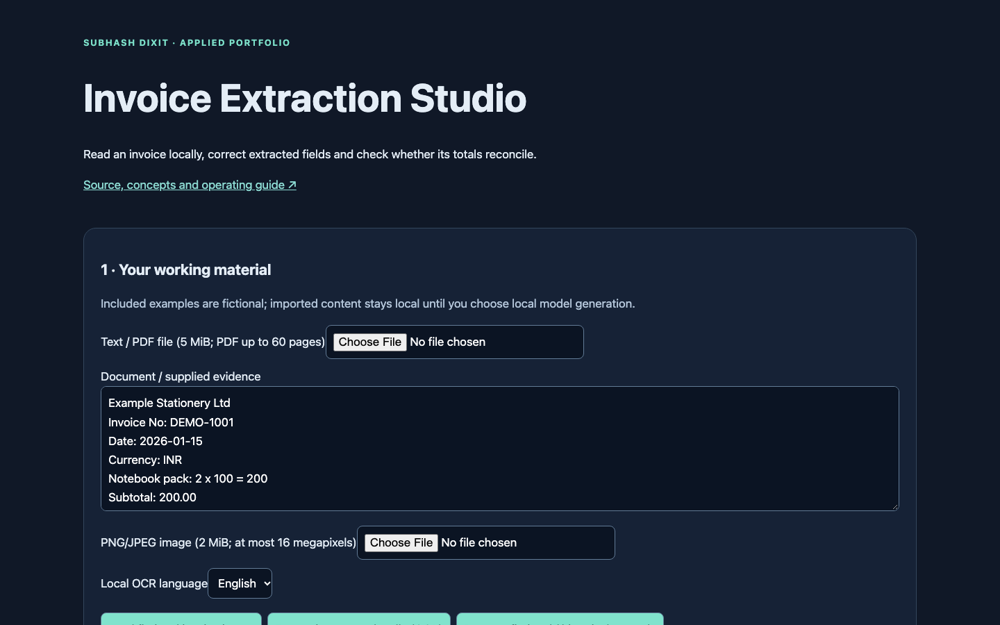
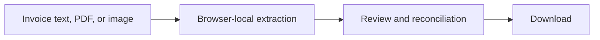
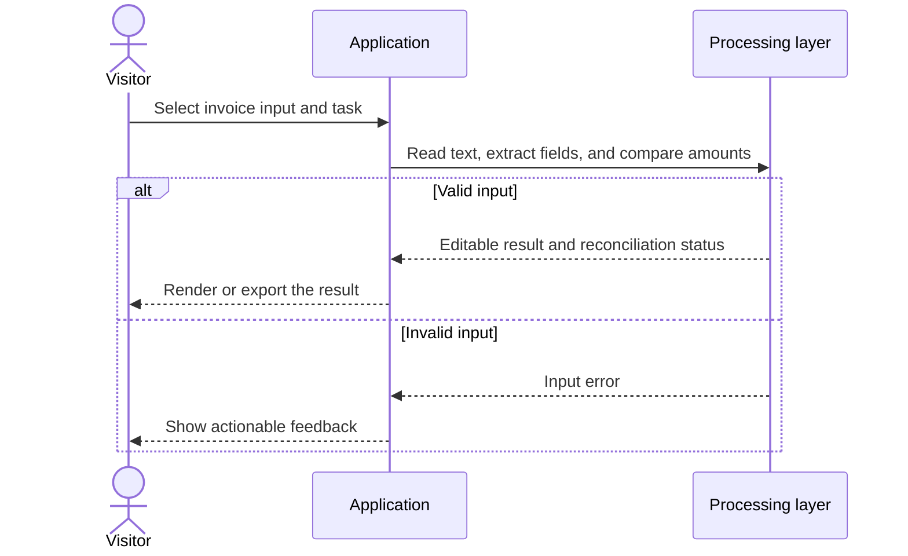
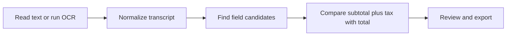
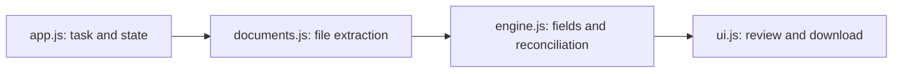
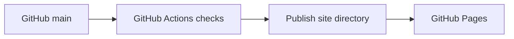

# Invoice Extraction Studio

## 1. Project overview

Turn invoice text or an image into editable structured fields, then check the extracted amounts against the original document.

[Live demo](https://subhashdixit.github.io/invoice-extraction-studio/) · [Source repository](https://github.com/subhashdixit/invoice-extraction-studio)



## 2. Motivation and problem statement

Invoice details arrive in PDFs and scans with different layouts. Copying amounts and identifiers by hand is slow and can introduce errors. This app reads supported material on the device, brings common fields into one review screen, and flags when subtotal plus tax differs from the reported total.

## 3. Solution and scope

Import text or a PDF with a readable text layer, or run local English/Hindi OCR on a supported invoice image. Extract fields, review them against the source, correct the output, and download it. Optional local AI handles questions about a text transcript or experimental image analysis.

## 4. Quick start and usage

1. Open the demo and choose the fictional invoice, paste text, or import a supported file.
2. For an image, choose the OCR language, run local OCR, and review the transcript.
3. Run the local tool to extract fields and check the totals. Correct the editable result against the original invoice.
4. If needed, opt into the local model download for a question about the transcript or experimental image analysis. Download the reviewed output.

## 5. High-level architecture



## 6. End-to-end request workflow



## 7. Data sources, inputs, and outputs

Inputs include pasted text, TXT/Markdown, text-layer PDFs, and PNG/JPEG images. The included invoice is fictional. Outputs include detected fields, missing values, reconciliation status, and an editable downloadable result. [Fictional invoice](site/samples/invoice-example.png)

## 8. Data flow and ETL pipeline



## 9. Low-level design and interfaces



`local-model-worker.js` loads the model selected in `model-policy.js` only when the user starts local generation. The interface provides progress, cancellation, and validation feedback.

## 10. Concepts and algorithms

| Concept | How and why it is used |
| --- | --- |
| PDF text extraction | PDF.js reads selectable text page by page and preserves page markers. Scanned pages without selectable text need OCR. |
| OCR | Tesseract estimates characters from pixels. Its confidence can help identify uncertain text, but it is not a calibrated accuracy estimate. |
| Rule-based extraction | Deterministic field parsing makes missing values and unusual invoice layouts visible during review. |
| Reconciliation | Compare subtotal plus tax with total. Discounts, shipping, and multiple tax lines can change the expected result. |
| Local model inference | Text models operate on the transcript. Experimental vision works on resized image pixels. Manual review remains necessary for amounts. |

## 11. Technology choices and dependencies

| Technology | Role and rationale |
| --- | --- |
| PDF.js | Read supported PDFs directly in the browser. |
| Tesseract.js | Recognize English and Hindi text locally from invoice images. |
| Transformers.js and ONNX Runtime Web | Run optional open-model inference in a browser worker. |
| JavaScript and GitHub Pages | Deliver a static interface with local review and export. |

[Dependency versions and reproducible setup](DEPENDENCIES.md)

[Model revisions and limits](site/model-policy.js) · [Vendored notices and versions](site/vendor/)

## 12. Training, inference, and evaluation

The maintained app uses deterministic field extraction and pretrained optional models. It has no project-specific training run or representative invoice accuracy benchmark. Unit tests cover the engine, input contracts, and model policy. The prior browser checks used a synthetic invoice to verify OCR and reconciliation, and exposed incorrect details from experimental vision. Run `npm test`. [Test sources](tests/)

## 13. Limitations and data handling

Use synthetic or authorized documents. Document limits include 5 MiB and 60 pages for supported PDFs, 2 MiB and 16 megapixels for images, and a 40,000-character text limit. Complex layouts, handwriting, and punctuation can lead to extraction errors. Model weights are downloaded on demand. Review all amounts against the invoice before exporting.

## 14. Installation and local setup

Install Node.js 22 and Python 3 for a local static HTTP server. Python is not a production backend for this app.

```bash
git clone https://github.com/subhashdixit/invoice-extraction-studio.git
cd invoice-extraction-studio
npm ci
npm test
npm run lint
npm run format
npm run check
python3 -m http.server 8000 --directory site
```

Open http://localhost:8000. Use HTTP rather than double-clicking HTML so that module imports and local data fetches work consistently. No production API secret belongs in `site/`.

## 15. Repository structure

```text
site/
  index.html       # accessible application interface
  styles.css       # responsive design
  app.js           # interface orchestration
  engine.js        # validated calculations; no DOM dependency
  ui.js            # chart, CSV and download helpers
tests/             # behavior and boundary cases
.github/workflows/pages.yml
archive/           # original README and retired workflows where present
```

Original source files, notebooks and historical artifacts remain in the repository for comparison. The release publishes only `site/`; old source directories and datasets are not automatically exposed by the application.

## 16. Deployment and operations



CI means continuous integration: each pull request and main-branch push installs exact lockfile dependencies, checks formatting, lints JavaScript, runs meaningful behavior tests and checks module syntax. A failed check stops publishing. CD means continuous deployment: after the required `Build and test` check succeeds on `main`, GitHub Actions uploads `site/` and GitHub Pages serves it over HTTPS.

The workflow uses pinned action revisions, minimal permissions and a protected main branch. Publishing jobs need Pages/OIDC permissions; test jobs only read source. Feature branches are deleted after merge. Static Pages hosting needs no always-running Python process, but cannot hide secrets, host a Flask process or provide durable server storage.

To set up a fork, enable GitHub Pages with **GitHub Actions** as its source and allow the repository's workflow to run. Repository Settings → Pages shows the deployment URL. If renaming the repository, update the README URL and any absolute links; application resources use relative paths. Check Actions logs if publishing fails.

### Release, monitoring and rollback

A commit identifies exactly which source was deployed. Inspect the Actions deployment and test results before sharing the link. After publishing, open the page, run its example and check exports; a successful HTTP response alone is not a functional test. For rollback, revert the faulty merge in a new PR, pass checks, and merge the revert. This triggers the same reproducible publishing process. Avoid force-pushing protected main or deleting history. Browser caches can retain an older asset briefly; refresh after a deployment.

### Docker and alternatives

Docker packages code and dependencies into a reproducible runtime. This static app does not require a container: Pages serves the same versioned files directly, with less operating work and no container cold starts. A container becomes useful if adding a Python backend; then secrets, patches, resource costs and persistent storage require separate management.

The shipped invoice interface processes OCR and model requests locally.

## 17. License, credits, and support

Project by **Subhash Dixit**. See the [repository license](LICENSE) for code terms. Report bugs or documentation issues with synthetic reproduction inputs.

[GitHub Issues](https://github.com/subhashdixit/invoice-extraction-studio/issues)

Third-party runtime and model notices are linked from the dependency documentation.
